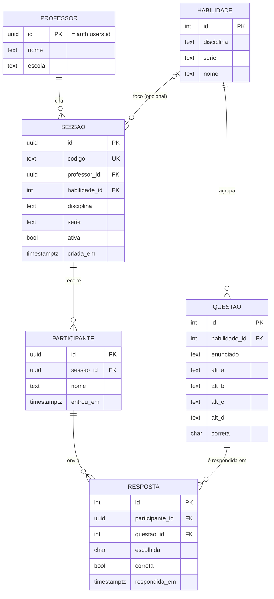

# Banco de dados: DER e modelo lógico

O script completo está em `supabase/schema.sql`. O diagrama abaixo usa Mermaid (o GitHub desenha sozinho).

## DER

## Modelo lógico
- **professor** (<u>id</u>, nome, escola) — id → auth.users(id)
- **habilidade** (<u>id</u>, disciplina, serie, nome)
- **questao** (<u>id</u>, habilidade_id → habilidade, enunciado, alt_a, alt_b, alt_c, alt_d, correta ∈ {A,B,C,D})
- **sessao** (<u>id</u>, codigo único, professor_id → professor, habilidade_id → habilidade [nulo = todas], disciplina, serie, ativa, criada_em)
- **participante** (<u>id</u>, sessao_id → sessao, nome [1–30], entrou_em)
- **resposta** (<u>id</u>, participante_id → participante, questao_id → questao, escolhida, correta, respondida_em) — único (participante_id, questao_id)

## Views de relatório
- `v_acertos_por_aluno`: por sessão e aluno — respondidas, acertos, percentual.
- `v_acertos_por_assunto`: por sessão e habilidade — respondidas, acertos, percentual.
Ambas usam `security_invoker`, então respeitam o RLS de quem consulta.

## Funções do aluno (sem login)
| Função | O que faz |
|---|---|
| `entrar_na_sessao(codigo, nome)` | Confere o código e se a sessão está aberta; cria o participante. |
| `buscar_questoes(participante, limite)` | Sorteia até 8 questões da habilidade, **sem** a alternativa correta. |
| `responder(participante, questao, letra)` | Corrige no servidor, grava e devolve verdadeiro/falso. |

## Segurança (testada localmente)
- Professora B não vê sessões, alunos nem relatório da professora A, e não consegue alterar as sessões dela.
- O papel `anon` (aluno) não lê nenhuma tabela diretamente.
